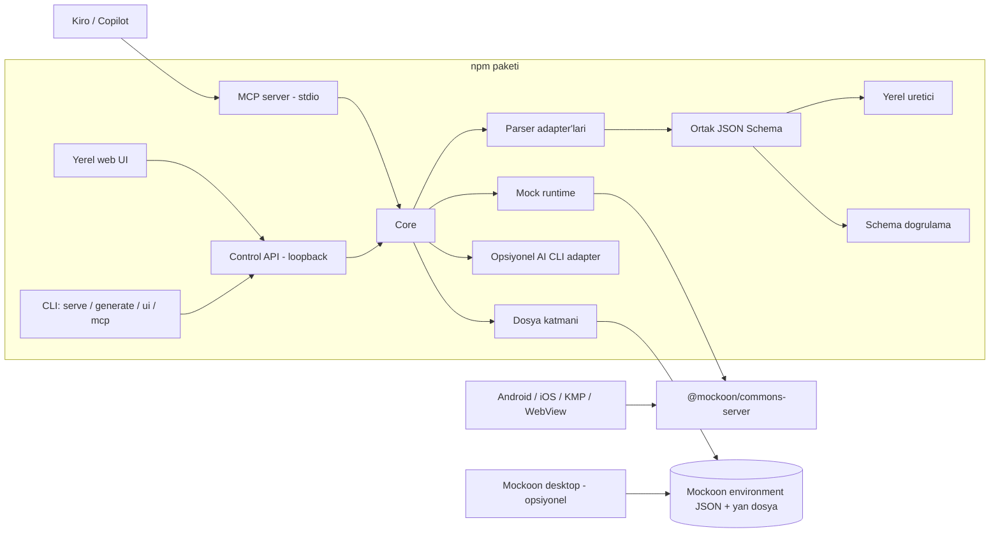

# Mimari ve Guvenlik

## Tasarim hedefleri

- Tek kullanicili, local-first ve offline calisan bir gelistirme araci.
- Mock calistirmayi yeniden yazmamak: Mockoon motoru kutuphane olarak kullanilir.
- Ayirt edici is (model parser, schema, uretim) motordan bagimsiz moduller olarak tutulur.
- Veri, Mockoon ile uyumlu ve git'e konabilen dosyalarda saklanir.
- Kullanici girdisi kod olarak calistirilmaz.

## Karar kaydi

| Secenek | Karar | Gerekce |
|---|---|---|
| Sifirdan mock server (Fastify) | Reddedildi | Path param, senaryo, latency, proxy, CORS, HTTPS, log gibi ozellikler Mockoon motorunda hazir. |
| Mockoon fork'u | Reddedildi | Angular/Electron bakim yuku, aktif upstream ile surekli merge, Electron uygulamasi icin ucretli kod imzalama/notarization, marka temizligi. Ayirt edici is fork'ta da ayni sekilde yazilacakti. |
| Mockoon eklentisi | Mumkun degil | Mockoon desktop'ta plugin/extension sistemi yok. |
| Mockoon motorunu kullanan bagimsiz npm paketi | **Secildi** | MIT, imzalama gerektirmez, `npx` ile her OS ve CI'da calisir, Mockoon desktop/CLI ile ayni dosyayi paylasir. |

Riskler:

- `@mockoon/commons-server` resmi olarak genel kullanima yonelik stabil bir API garantisi vermez. Surum exact pin'lenir, entegrasyon testleriyle korunur ve guncelleme kontrollu yapilir.
- Mockoon dosya formati degisirse migration Mockoon paketleriyle gelir; arac kendi yan dosyasinin formatini ayrica version'lar.

## Bilesenler

- **CLI:** `init` (proje olusturur), `ui` (yerel web UI'i acar), `serve` (mock'lari UI olmadan calistirir), `generate` (modelden JSON uretir, istenirse projeye senaryo olarak kaydeder), `check` (bagli modelleri kaynakla karsilastirir), `export openapi`, `snippets` (baglanti rehberi) ve `mcp` (MCP server'i stdio uzerinden baslatir).
- **Yerel web UI:** React + TypeScript + Vite. Collection yonetimi, endpoint ve senaryo duzenleme, modelden uretim, start/stop ve loglar. Ileri route kurallari, proxy ve sablonlama icin Mockoon desktop ayni dosya ile kullanilabilir.
- **Control API:** Fastify; UI asset'lerini sunar ve yonetim API'sini verir. Yalnizca loopback.
- **Core:** Domain modeli, cakisma kontrolu, dosya okuma/yazma, runtime yonetimi. UI, CLI ve MCP ayni core'u kullanir.
- **Mock runtime:** Aktif collection'lardan bir Mockoon environment'i olusturur ve `@mockoon/commons-server` ile calistirir.
- **Parser adapter'lari:** Gson, Kotlinx Serialization ve Swift Codable icin ayri adapter'lar; ortak AST katmani (aday: tree-sitter WASM grammar'lari).
- **Yerel uretici:** Alan adi heuristic'leri ile deterministik veri; varyant uretimi.
- **AI:** MCP server birincil entegrasyon; AI CLI adapter'i sonraki asama.

## Veri modeli ve dosyalar

Bir project, kullanicinin sectigi klasorde (or. mobil app reposunda `mocks/`) tutulur:

- **Mockoon environment dosyasi** (`<ad>.environment.json`): Route'lar, response'lar (senaryolar), header'lar, latency, CORS, port ve hostname. Mockoon CLI ile dogrudan calisir. Bu dosya port, hostname, CORS ve proxy ayarlarinin tek kaynagidir.
- **Yan dosya** (`<ad>.studio.json`, `schemaVersion: 1`): Araca ozel metadata. `environmentFile` (ayni klasorde duz dosya adi), collection aktif/pasif durumlari (folder uuid'si ile), endpoint basina model baglantisi (`rootType`, naming/tarih ayarlari, kaynak dosyalar, JSON Schema), CORS modu, uretim varsayilanlari, `logBodies` ve `allowTemplating`. Kaynak dosya yollari yan dosyanin bulundugu proje klasorune gore goreli yazilir (`../app/Order.kt` gibi; mutlak yol yazilmaz) ve okunurken `--root` (varsayilan: proje klasoru) icinde kalmalidir; proje klasoru disindaki modeller icin `ui`, `check` ve `mcp` `--root <repo koku>` ile baslatilir. Semadan konum bilgisi (`x-source`) cikarilir.

Eslesme:

| Urun kavrami | Mockoon karsiligi (M0'da dogrulandi) |
|---|---|
| Project | Environment (tek port) |
| Collection | Kok seviyedeki folder; folder disindaki route'lar "Ungrouped" sanal collection'i |
| Endpoint | Route (`http` tipi; CRUD/WebSocket route'lari salt okunur gosterilir) |
| Senaryo | Route response; `label` = ad, `default` = aktif senaryo |
| Latency, status, header, body | Route response alanlari |

Kurallar:

- Body ham string olarak saklanir ve oldugu gibi sunulur; dogrulama icin ayri parse edilir.
- Yazma islemleri atomiktir (gecici dosya + rename). Dosya izleme ile dis degisiklikler (git pull, Mockoon desktop) algilanir; kaydedilmemis degisiklikle cakisirsa kullaniciya sorulur.
- Kalici ID'ler korunur; JSON pretty-print ve kararli alan sirasi ile yazilir (git diff okunabilirligi).
- Yan dosyada bilinmeyen gelecek major `schemaVersion` sessizce yuklenmez.
- Dosyalar absolute path, kullanici adi, credentials veya token icermez.

## Route cozumu ve collection birlestirme

- Mockoon motoru ilk eslesen route'u secer; cakismayi kendisi raporlamaz. Bu yuzden cakisma kontrolu core'da, runtime'a gecmeden once yapilir.
- Cakisma, normalize edilmis method + path uzerinden kontrol edilir; parametreli path'lerde (`/users/:id` ile `/users/me`) olasi golgeleme uyari olarak gosterilir.
- Collection aktif edildiginde veya endpoint degistiginde kontrol tekrar calisir.
- Pasif collection'larin route'lari runtime'a verilmez: runtime, dosyadaki environment'tan route'lari cikararak turetilmis bir environment kurar; dosya degismez (Mockoon desktop tum route'lari gosterir).
- Degisiklikler restart gerektirmeden `MockoonServer.updateEnvironment()` ile yansir. Yalniz port veya host degisirse runtime sunucuyu durdurup yeni adresle yeniden baslatir.
- Eslesmeyen istekler icin yontem: motor 404'u kendisi JSON yapmadigi icin turetilmis environment'a, OPTIONS haric her method icin bir catch-all route (`{*splat}`) eklenir; OPTIONS haric tutulur cunku preflight'i motorun CORS isleyicisi karsilar. Bu route'larin uuid'leri log'da "eslesmedi" isareti olarak kullanilir. Proxy acikken catch-all eklenmez.
- Collection sirasi ve folder icindeki endpoint sirasi motorun route onceligidir; cakisma kontrolu bu sirayi kullanir.

## Modelden schema'ya donusum

1. Kullanici `.kt`/`.swift` dosyasi, klasor secer veya kod yapistirir.
2. Uygun adapter AST uzerinden tipleri cikarir; dosya derlenmez ve calistirilmaz.
3. Tipler ortak JSON Schema'ya cevrilir: nullable/optional, default degerler, enum, liste, map, nested type, basit generic'ler ve JSON alan adlari.
4. Uretim ayarlari uygulanir: naming strategy, tarih formati, `Long` icin guvenli sayi araligi.
5. Yerel uretici deterministik ornek ve istenen varyantlari uretir.
6. Cikti JSON parse ve schema validation'dan gecer, endpoint senaryosu olarak kaydedilir.

Schema dogrulamasi decoder uyumlulugunu garanti etmez; en buyuk risk naming ve tarih stratejileridir. Bu ayarlar UI'da gorunur ve yan dosyada saklanir.

JSON Schema Draft 2020-12 kullanilir; parser `web-tree-sitter` 0.24.7 ile `tree-sitter-wasms` 0.1.13'tur. Regex ile kismi parse yapilmaz; hata konumu ve desteklenmeyen yapilar raporlanir.

## AI entegrasyonu

### MCP server (birincil)

- Stdio uzerinden calisir; ag portu acmaz. Stdout yalnizca protokole aittir.
- Tool'lar dar kapsamlidir: `list_collections`, `parse_model`, `get_schema`, `generate_sample` (deterministik taslak), `validate_body`, `save_scenario`.
- Dosya erisimi `--root` (varsayilan: proje klasoru) ile sinirlidir; `..`, mutlak yol ve symlink ile cikis reddedilir. Yazma yalnizca proje dosyalarina, `ProjectService` uzerinden yapilir; shell veya keyfi dosya yazma tool'u yoktur.
- `save_scenario` body'yi verilen modele veya endpoint'e bagli modele gore dogrular (bagli model yalnizca 2xx senaryolari icin gecerlidir; 404/500 gibi hata response'lari basarili response modeline gore denetlenmez); gecersiz body ve gecersiz JSON kaydedilmez.
- Veri gonderim onayi AI istemcisinin (Kiro, Copilot) kendi onay akisiyla yapilir.

### AI CLI adapter

- Provider interface'i (`AiProvider`) disinda belirli bir CLI'a bagimlilik olmaz; su an tek provider GitHub Copilot CLI'dir. Yalnizca `mock-studio ui --ai copilot` ile acilir ve proje dosyasinda saklanmaz (repoda paylasilan bir dosya, bir CLI'i calistirmaya yonlendirememelidir).
- Yalnizca kullanicinin Generate aksiyonuyla cagrilir; gonderilecek prompt (JSON Schema, istege bagli kullanici istegi ve istege bagli model kaynagi) once tam metin olarak gosterilir; onay, onizlenen promptun hash'i ile verilir ve prompt degisirse reddedilir.
- CLI'lar agent oldugu icin bos bir gecici calisma dizininde, bos bir gecici yapilandirma klasoruyle (`--config-dir`; kullanicinin MCP sunuculari, hook'lari ve eklentileri yuklenmez), arac listesi bosaltilmis ve `shell`/`write` reddedilmis olarak baslatilir. Model kaynagindaki yorumlar prompt injection riski tasir: kaynak veri olarak isaretlenir, CLI'in araci yoktur ve cevap semaya gore dogrulanir.
- Shell string interpolation yoktur; prompt tek argv elemanidir. Ortam degiskenleri izin listesiyle aktarilir (`PATH`, `HOME`, proxy ayarlari, `COPILOT_*`, `GH_*`, `GITHUB_*`...).
- Timeout (varsayilan 120 sn), iptal (istemci baglantisi koparsa process oldurulur), cikis kodu, 2 MB cikti siniri ve stdout JSON dogrulamasi ele alinir; basarisizlikta yerel uretici kullanilir.
- CLI paketlenmez; kullanicinin kendi kurulumu ve lisansi kullanilir.

## Mobil istemci baglantisi

- Android Emulator: `http://10.0.2.2:<port>`. Mock listener `127.0.0.1`'de dinlerken de calisir.
- iOS Simulator: `http://localhost:<port>`.
- Android fiziksel cihaz: `adb reverse tcp:<port> tcp:<port>` ile LAN acmadan `localhost`.
- iOS fiziksel cihaz: LAN binding acik kullanici secimiyle acilir; makinenin LAN IP'si kullanilir.
- Android cleartext: targetSdk 28+ icin debug source set'te `network_security_config` ile yerel adreslere izin verilmelidir.
- iOS ATS: debug `Info.plist` icinde `NSAllowsLocalNetworking` gerekebilir.
- Arac bu debug yapilandirma snippet'lerini dokumante eder veya uretir; production yapilandirmasi degistirilmez.

## CORS

- Native Android/iOS HTTP istemcileri CORS'a tabi degildir.
- CORS gereken senaryolar: WebView, KMP web/wasm hedefleri, browser istemcileri ve yerel UI'dan mock endpoint denemek.
- Motorun CORS ve OPTIONS preflight destegi kullanilir. Credentials iceren isteklerde `*` yerine origin yansitma kullanilir.

## Guvenlik varsayilanlari

- Control API yalnizca `127.0.0.1`'e bind edilir; Host/Origin kontrolu ve kisa omurlu yerel token ile korunur (DNS rebinding'e karsi).
- Mock listener varsayilan `127.0.0.1`; LAN binding yalnizca acik kullanici secimiyle.
- Dosya islemleri secili project klasoruyle sinirlidir; path traversal reddedilir. Import edilen dosyalar boyut, tip ve sema acisindan dogrulanir.
- Request loglarinda Authorization, cookie ve API key basliklari maskelenir; body loglama varsayilan kapalidir.
- Telemetri yoktur; model kaynagi, prompt veya body hicbir servise otomatik gonderilmez.
- **Control API ayrintilari:** `Host` basligi `127.0.0.1:<port>` veya `localhost:<port>` olmali; varsa `Origin` ayni adreslerden biri olmali; `/api/*` icin `Authorization: Bearer <token>` zorunludur (sabit sureli karsilastirma, 8 saat omur); CORS basligi yoktur; `Content-Security-Policy`, `X-Frame-Options`, `nosniff`. Token URL fragment'i ile UI'a verilir (sunucuya gitmez) ve yalniz sekme oturumunda tutulur.
- **Guvenli mod (varsayilan):** Mockoon templating helper'lari, data bucket'lar, callback'ler ve CRUD/WebSocket route'lari paylasilan bir dosyadan kod calistirabilir (`@faker-js/faker` `helpers.fake` icin yuksek siddetli advisory'si acik; Mockoon paketleri bu surume bagli). Bu yuzden runtime, proje `allowTemplating` ile acik izin vermedikce bunlari kapatir: tum response'larda `disableTemplating`, callback ve data bucket'lar bos, template soz dizimi iceren header degerleri oldugu gibi (escape edilerek) sunulur, `templating`/`data_bucket`/`global_var` kurallari yok sayilir, data bucket body'si 501 doner. Dosyanin kendisi degismez; UI ve `view` neyin kapatildigini listeler. Arac kendi catch-all 404 route'larinda ve CORS origin yansitma header'inda kendi sabit template'lerini kullanir.
- **Proxy:** Varsayilan kapali. Acikken eslesmeyen istekler (Authorization ve cookie dahil) girilen backend'e iletilir; adres `http(s)` olmali, kimlik bilgisi icermemeli ve mock sunucunun kendisini gostermemeli.
- **Model baglantilari** istemciden gelir: kaynak konumlari (`x-source`) cikarilir, mutlak veya `..` iceren yollar atilir, sema boyutu sinirlanir.
- Parser kaynak kodu calistirmaz ve ayri bir process'te calisir; cokmesi ana sureci etkilemez, 30 sn zaman asimi, dosya basina 1 MB ve en fazla 500 dosya siniri vardir.

## Model degisikligi kontrolu ve OpenAPI

- `check` / `GET /api/models/check`: her model baglantisinin kaynak dosyalarini yeniden okur, yeni semayi kayitli semayla karsilastirir (`schema-diff`: eklenen/silinen/tipi degisen alan, zorunlu ve nullable degisiklikleri, enum degisiklikleri, tarih kodlamasi; recursive tipler icin dongu korumasi) ve kayitli body'leri yeni semaya karsi dogrular. Yapistirilarak veya yuklenerek verilen modellerin kaynak yolu olmadigi icin "kontrol edilemez" sayilir. "Yeni modeli kabul et" kayitli semayi gunceller; body'leri guncellemek kullanicidadir.
- `export openapi`: endpoint ve senaryolardan OpenAPI 3.1 uretir; 2xx response'lari bagli modelin semasina (`components.schemas`) ve ornek body'lere baglar. Sozlesme onerisidir, otorite degildir.

## M0 teknik dogrulama sonuclari

Dogrulama, calisan prototipler ve sonra bunlari kapsayan testlerle yapildi (surumler exact: `@mockoon/*` 9.10.0).

- `MockoonServer(environment, options)`; olaylar `started`, `stopped`, `error` (kodlari `ServerErrorCodes`) ve `transaction-complete` (istek/response, `routeUUID`, `routeResponseUUID`, `proxied`). `updateEnvironment()` route ve response degisikliklerini restartsiz uygular; 64-bit sayilar body'de aynen korunur (body ham string'dir).
- Ilk eslesen route kazanir; sira `rootChildren` sirasidir ve klasorler yerinde acilir (`/users/:id` once gelirse `/users/me` golgelenir).
- `method: all` olan `{*splat}` route'u OPTIONS'i de yakalayip CORS isleyicisinin onune gecer; bu yuzden catch-all'lar method basina uretilir.
- CORS: `environment.cors = true` yalniz OPTIONS isleyicisini acar; normal response'lardaki `Access-Control-*` header'lari `environment.headers` ile verilir. Origin yansitma: `Access-Control-Allow-Origin: {{header 'Origin'}}` + `Allow-Credentials: true` + `Vary: Origin`.
- Mockoon migration'lari (`lastMigration` 33) yuklemede uygulanir; daha yeni `lastMigration` acik hata verir. Yukleme dogrulamasi Mockoon'un kendi `EnvironmentSchema`'sidir.
- tree-sitter: `web-tree-sitter` 0.27, `tree-sitter-wasms` 0.1.13 ile `dylink` bicimi uyumsuzlugundan yuklenemez; 0.24.7 ile Kotlin ve Swift grammar'lari yuklenir. Node 24 ve 25'te V8'in optimize edici WASM derleyicisi bu grammar'larda bellek yetersizligiyle cokuyor (`Fatal process out of memory: Zone`, cikis kodu 133); Node 22'de yok. `--liftoff-only` sorunu cozer ama `NODE_OPTIONS` ile verilemez ve `v8.setFlagsFromString()` etkisizdir; bu yuzden parser, bu bayrakla baslatilan bir child process'tir.
- `npm audit` (production): `@faker-js/faker` (code execution advisory'si) ve `joi` (kuadratik sureli DoS advisory'si) Mockoon paketleri uzerinden gelir; `npm audit fix` Mockoon'u eski surume dusurur ve kabul edilmez. Faker riski guvenli modla kapatilir; Mockoon guncellemesinde advisory'ler yeniden kontrol edilir.
- Lisans taramasi (production agaci, 234 paket): hepsi izin verici lisansli; tek istisna Mockoon'un bagimliligi `@jmespath-community/jmespath` (MPL-2.0, degistirilmeden kullanilir) [NOTICE.md](../NOTICE.md) icinde belirtilir.
- MCP SDK 1.32.2 (`registerTool`, zod 4 ile calisir); paket adi `@mock-api-studio/studio`.

## Runtime ve platform

- Kurulu Node.js gerekir; `engines` alani `>=22.12.0`'dir (Mockoon motoru Node 18+ ister, UI build araclari 22.12+ ister). Test edilenler: 22.23, 24.22 ve 25.9. Uyumsuz surumde acik hata ve kurulum yonlendirmesi verilir; arac su an Node kurmaz. 2026-11-08 karariyla bu degisecek: kurulum araci gerekirse ozel bir Node runtime kurar (bkz. [Dagitim ve guncelleme](#dagitim-ve-guncelleme), M13).
- Hedef platformlar: macOS, Windows, Linux. Test matrisi `.github/workflows/ci.yml` icindedir (macOS ve Linux; Node 22 ve 24). macOS disinda calistirilmadi; Windows bu matriste yoktur ve acik maddedir.
- Tek binary veya Docker dagitimi MVP sonrasi degerlendirilir.

## v1 tasarimlari (oneri)

Durum: **oneri**, uygulanmadi. Kullanici kararlari 2026-11-08'de alindi; asagidaki tasarimlar o kararlara gore yazildi ve uygulama sirasinda koddaki gercek davranisla dogrulanmalidir. Milestone ve kabul kriterleri: [Roadmap - v1 plani](ROADMAP.md#v1-plani-m6-m17).

### Karar kaydi eki (2026-11-08, kullanici)

| Konu | Karar |
|---|---|
| Mockoon motoru | Kabul. MIT lisansli, ucretsiz ve acik kaynak oldugu icin motor paketleri kutuphane olarak kullanilmaya devam eder. |
| Node.js | Son kullanici urunu: Node yoksa kurulum araci kurar; kurulum ve guncelleme kolay olmalidir (M13). Onceki "arac Node kurmaz" karari bu kararla degisir. |
| Collection paylasimi | Postman benzeri export/import plana alindi (M12). Dosya/git tabanli paylasim da devam eder. |
| AI CLI | Makinede kurulu AI CLI'lari (Claude Code, Codex, Copilot, Gemini, Kiro CLI vb.) ile uretim (M11). |
| Kullanim modeli | Gelistirme sirasinda LLM'ler araci MCP ile otomatik kullanir; test sirasinda kullanici dashboard'u kullanir. |
| Lisans ve yayin | Kisisel acik kaynak proje (MIT), GitHub'da yayinlanacak. Herhangi bir sirketle baglantisi yoktur. |

### Kosullu response'lar

**Kavram.** Status kodu bir *kosul* degil, bir *sonuctur*: kosullar hangi **senaryonun** donecegini secer; senaryo status, header, body ve gecikmeyi birlikte tasir. Boylece "header X yoksa 401", "query `page=99` ise bos liste", "body'de `type=premium` ise farkli fiyat", "ilk istek 500, sonraki 200" gibi durumlarin hepsi ayni mekanizmayla kurulur.

**Motor eslemesi.** Mockoon'un route response kurallari kullanilir (dosyada zaten calisiyor; `@mockoon/commons` 9.10.0 tipleri):

| Bizim kavram | Mockoon alani |
|---|---|
| Senaryo kosullari | `RouteResponse.rules[]` (`target`, `modifier`, `value`, `operator`, `invert`) |
| Kosullarin birlesimi | `RouteResponse.rulesOperator`: `AND` / `OR` |
| Varsayilan senaryo | `RouteResponse.default` |
| Endpoint modu | `Route.responseMode`: `null` (kurallar, eslesmezse varsayilan), `DISABLE_RULES` (her zaman secili senaryo), `SEQUENTIAL`, `RANDOM`, `FALLBACK` |

Desteklenecek hedefler: `header`, `query`, `params` (route parametresi), `body` (JSON path, or. `$.user.type` veya `user.type`; form alanlari), `cookie`, `request_number`, `method`. `templating`, `data_bucket`, `global_var` guvenli modda kapali kalir (mevcut davranis). Operatorler: `equals`, `regex`, `regex_i`, `null`, `empty_array`, `array_includes`; `valid_json_schema` data bucket gerektirdigi icin ilk surumde yok.

**Secim sirasi.** Motor, kurali olan senaryolari listedeki sirayla dener; ilk eslesen doner, hicbiri eslesmezse varsayilan senaryo doner. UI'da sira suruklenebilir ve "ilk eslesen kazanir" acikca gosterilir. Uygulamada dogrulanacak: kurali olmayan senaryolarin degerlendirmede nasil ele alindigi ve `request_number` sayacinin `updateEnvironment()` sonrasi sifirlanip sifirlanmadigi.

**Zorla secim (`X-Mock-Scenario`).** Runtime'in turettigi environment'ta (dosyaya yazilmaz) her senaryonun gizli bir kopyasi, tek kurali `header X-Mock-Scenario equals <senaryo adi veya id>` olacak sekilde listenin basina eklenir. Boylece header her kosulu ezer; log, kopyayi asil senaryo adiyla gosterir. Proje ayariyla kapatilabilir. Mobil uygulamanin debug menusu bu header'i ekleyerek ekran ekran senaryo secebilir.

**"Neden bu response" gorunumu.** Log satiri secilen senaryoyu ve secilme nedenini (eslesen kural, varsayilan, sirali, zorla secim, test profili) gosterir. Once motorun olaylarinin (secilen response uuid'i vb.) ne raporladigi incelenir. Eslesen kural motordan alinamiyorsa core'da yeniden degerlendirme yalniz gosterim icindir; iki sonuc farkliysa uyari loglanir ve motor davranisi esas alinir. Bu, motorla zamanla davranis farki olusma riskine karsi bilincli bir sinirdir.

**Test profilleri (M8).** Yan dosyada `profiles: { [ad]: { endpoints: { [endpointId]: { scenarioId, mode? } }, network?: {...} } }`. Profil aktifken runtime, turetilmis environment'ta ilgili route'larin varsayilan senaryosunu ve modunu degistirir (`DISABLE_RULES`); dosyadaki asil secim degismez. Ag kosullari yalniz motorun dogal destekledigi sabit gecikme ve zaman asimi ile sinirlidir; rastgele hata orani ve jitter 2026-11-08'de kapsamdan cikarildi (tekrarlanamaz testler, motor disi katman ihtiyaci).

### Model degisikliginde body guncelleme

- Girdi: kayitli sema, yeni sema, senaryo body'si. Cikti: onerilen yeni body + degisiklik listesi.
- Algoritma: body yeni semaya gore yuruyerek birlestirilir. Var olan ve hala gecerli degerler korunur; yeni zorunlu alanlar (istege bagli olarak opsiyonel alanlar da) yerel ureticiyle, alan adi heuristic'leri ve sabit seed ile uretilir; semada olmayan alanlar kaldirilir; tipi degisen veya enum disi kalan deger yeniden uretilir; nullable'dan zorunluya gecen `null` deger uretilir. Diziler eleman bazinda ayni kuralla islenir.
- Ham body metni korunarak yazilir (64-bit sayi hassasiyeti icin degismeyen sayilarin orijinal metni saklanir).
- Yalniz modele bagli 2xx senaryolar guncellenir; 4xx/5xx'e dokunulmaz.
- Onay olmadan dosyaya yazilmaz (CLI `--yes`, MCP onizleme + uygulama, UI fark ekrani). Yazma ayni `STALE` korumasini kullanir.

### Yan dosya surum gecisi

Profil, degisken ve endpoint modu yan dosyaya eklendiginde `schemaVersion` 2 olur. Yukleyici v1 dosyasini bellekte v2'ye kayipsiz cevirir ve ilk kaydetmede v2 olarak yazar; v2 dosyasi v1 destekleyen eski surumde mevcut "UNSUPPORTED_VERSION" hatasiyla reddedilir. Her surum gecisi fixture tabanli migration testiyle korunur.

### AI provider kaydi

- MCP kurulumu: `mcp install`, istemcinin resmi komutunu (`claude mcp add`, `codex mcp add`) onayla calistirir; resmi komutu olmayan istemciler icin yalniz yapilandirma parcasi gosterilir, istemci dosyalari dogrudan duzenlenmez.
- `AiProvider` arayuzu genisletilir: `detect()` (yalniz `PATH` taramasi ve `--version`), `buildInvocation(prompt)` (argv, env izin listesi, gecici config/cwd), `parseOutput()`. Provider'lar: `claude`, `codex`, `copilot`, `gemini`, `kiro-cli`.
- Her provider icin etkilesimsiz bayraklar, arac/izin kapatma ve izole yapilandirma secenekleri uygulama sirasinda o CLI'in guncel dokumanindan dogrulanir; varsayim yazilmaz. Izolasyon saglanamayan provider "sinirli" olarak gosterilir.
- Mevcut kurallar tum provider'lar icin aynen gecerlidir: onizleme + hash'li onay, shell yok, prompt tek argv elemani, timeout, cikti siniri, sema dogrulamasi, yerel uretime donus.
- Not (2026-11-08, bu makinede `command -v`): `claude`, `codex`, `copilot`, `gemini` mevcut; `kiro-cli` yok (`kiro` IDE baslaticisi var, CLI degil).

### Import ve export

- Paket formati `*.mockstudio.json`: `{ format: "mock-api-studio/bundle", version: 1, collections: [...] }`; her collection endpoint, senaryo, kural, endpoint modu, model baglantisi ve semayi tasir. Kimlikler import'ta yeniden uretilir.
- Import akisi: parse -> dogrula (boyut siniri, sema, guvenli mod notlari) -> onizleme (eklenecek/cakisan endpoint'ler) -> cakisma secimi -> tek atomik yazma.
- Donusturuculer `src/core/import/` altinda saf fonksiyonlardir (Mockoon bagimsiz): Postman v2.1, OpenAPI 3.x, HAR, cURL. Desteklenmeyen ogeler (script, auth helper, ornek olmayan request) raporlanir, sessizce atlanmaz.

### Dagitim ve guncelleme

- **Birincil yol tek binary (Node SEA).** M6 prototipi basariliysa her platform icin Node gomulu binary uretilir; parser child process'i ayni binary'yi alt komutla calistirir, tree-sitter WASM ve UI asset'leri SEA asset'i olarak gomulur. Guncelleme Homebrew/Scoop/winget ile yapilir. Asagidaki ozel runtime tasarimi yalniz SEA basarisiz olursa uygulanir.
- Yerlesim (yedek yol): `~/.mock-studio/runtime/node-<surum>/` (ozel Node), `~/.mock-studio/app/<surum>/` (arac), `~/.mock-studio/bin/mock-studio` (baslatici). Sistem Node'u uygunsa (>= 22.12) kullanilabilir; varsayilan ozel runtime'dir (surum tutarliligi icin).
- Kurulum betigi resmi `nodejs.org` dagitimini indirir ve `SHASUMS256.txt` ile dogrular; `sudo` ve sistem dizinlerine yazma yoktur; PATH degisikligi kullaniciya gosterilip onayla yapilir.
- `mock-studio update`: GitHub Releases veya npm'den surum bilgisini yalniz kullanici komutuyla ceker; yeni surumu yan klasore kurar, baslaticiyi atomik olarak degistirir, bir onceki surumu `rollback` icin saklar.
- Not: uretim bagimliliklarinda native `.node` modulu yok (2026-11-08 kontrolu); bu SEA'yi olasi kilar ama dogrulanmadi.
