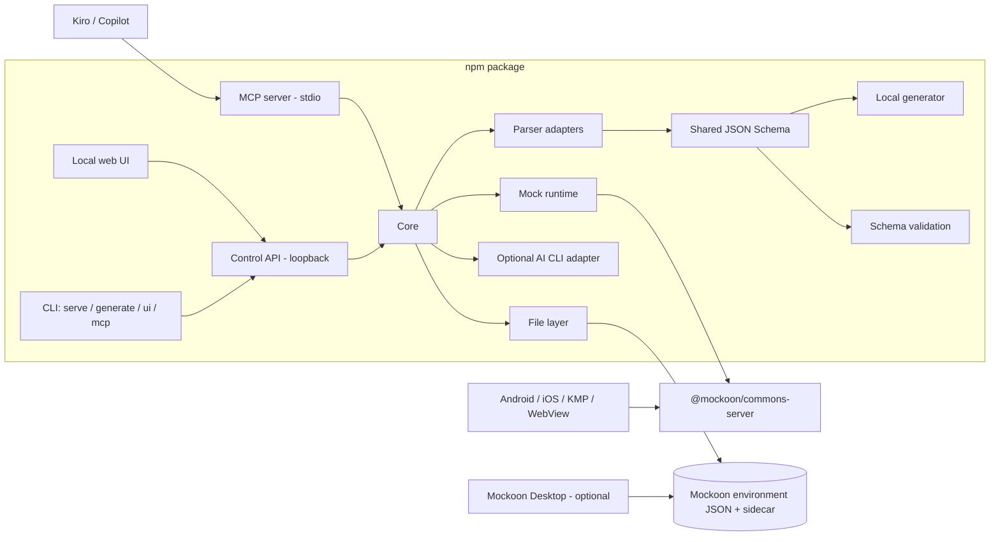

# Architecture and Security

## Design goals

- A single-user, local-first development tool that works offline.
- Do not rewrite mock execution: use the Mockoon engine as a library.
- Keep the distinctive work (model parser, schema, generation) in engine-independent modules.
- Store data in files that are compatible with Mockoon and can be committed to git.
- Never execute user input as code.

## Decision log

| Option | Decision | Rationale |
|---|---|---|
| Build a mock server from scratch (Fastify) | Rejected | The Mockoon engine already provides path parameters, scenarios, latency, proxy, CORS, HTTPS, and logging. |
| Fork Mockoon | Rejected | Angular/Electron maintenance burden, continuous merges with upstream, paid code signing/notarization for an Electron app, and brand cleanup. The distinctive work would still have to be written in the fork. |
| Mockoon plugin | Not possible | Mockoon Desktop has no plugin/extension system. |
| Standalone npm package using the Mockoon engine | **Selected** | MIT, no signing required, runs on every OS and in CI with `npx`, and shares the same file with Mockoon Desktop/CLI. |

Risks:

- `@mockoon/commons-server` does not officially guarantee a stable API for general use. Pin the exact version, protect it with integration tests, and update it in a controlled manner.
- If the Mockoon file format changes, migrations come with Mockoon packages; the tool versions its own sidecar file format separately.

## Components

- **CLI:** `init` (creates a project), `ui` (opens the local web UI), `serve` (runs mocks without the UI), `generate` (generates JSON from a model and optionally saves it to the project as a scenario), `check` (compares linked models with their sources), `export openapi`, `snippets` (connection guide), and `mcp` (starts the MCP server over stdio).
- **Local web UI:** React + TypeScript + Vite. Collection management, endpoint and scenario editing, model-based generation, start/stop, and logs. Mockoon Desktop can be used with the same file for advanced route rules, proxy, and templating.
- **Control API:** Fastify; serves UI assets and exposes the management API. Loopback only.
- **Core:** Domain model, conflict detection, file reads/writes, and runtime management. The UI, CLI, and MCP all use the same core.
- **Mock runtime:** Creates a Mockoon environment from active collections and runs it with `@mockoon/commons-server`.
- **Parser adapters:** Separate adapters for Gson, Kotlinx Serialization, and Swift Codable; a shared AST layer (candidate: tree-sitter WASM grammars).
- **Local generator:** Deterministic data using field-name heuristics; variant generation.
- **AI:** The MCP server is the primary integration; the AI CLI adapter is a later phase.

## Data model and files

A project is stored in a folder chosen by the user (e.g. `mocks/` in a mobile app repository):

- **Mockoon environment file** (`<name>.environment.json`): Routes, responses (scenarios), headers, latency, CORS, port, and hostname. Runs directly with the Mockoon CLI. This file is the single source of truth for port, hostname, CORS, and proxy settings.
- **Sidecar file** (`<name>.studio.json`, `schemaVersion: 1`): Tool-specific metadata. `environmentFile` (plain filename in the same folder), collection active/inactive states (using folder UUIDs), model links per endpoint (`rootType`, naming/date settings, source files, JSON Schema), CORS mode, generation defaults, `logBodies`, and `allowTemplating`. Source file paths are written relative to the project folder containing the sidecar (e.g. `../app/Order.kt`; absolute paths are not written) and must remain inside `--root` when read (`--root` defaults to the project folder); for models outside the project folder, start `ui`, `check`, and `mcp` with `--root <repo root>`. Location information (`x-source`) is removed from the schema.

Mapping:

| Product concept | Mockoon equivalent (verified in M0) |
|---|---|
| Project | Environment (single port) |
| Collection | Top-level folder; routes outside folders appear in the virtual "Ungrouped" collection |
| Endpoint | Route (`http` type; CRUD/WebSocket routes are shown read-only) |
| Scenario | Route response; `label` = name, `default` = active scenario |
| Latency, status, header, body | Route response fields |

Rules:

- Bodies are stored as raw strings and served as-is; they are parsed separately for validation.
- Writes are atomic (temporary file + rename). File watching detects external changes (git pull, Mockoon Desktop); if there is an unsaved-change conflict, the user is prompted.
- Persistent IDs are preserved; files are written with JSON pretty-printing and stable field order (for readable git diffs).
- An unknown future major `schemaVersion` in the sidecar is not loaded silently.
- Files do not contain absolute paths, usernames, credentials, or tokens.

## Route resolution and collection merging

- The Mockoon engine selects the first matching route and does not report conflicts. Therefore, the core checks for conflicts before passing routes to the runtime.
- Conflicts are checked using normalized method + path; possible shadowing in parameterized paths (such as `/users/:id` and `/users/me`) is shown as a warning.
- The check runs again when a collection is activated or an endpoint is changed.
- Routes from inactive collections are not passed to the runtime: the runtime builds a derived environment by removing routes from the environment in the file; the file is unchanged (Mockoon Desktop shows all routes).
- Changes are applied without a restart via `MockoonServer.updateEnvironment()`. If only the port or host changes, the runtime stops the server and restarts it at the new address.
- For unmatched requests: because the engine does not return JSON for 404s on its own, a catch-all route (`{*splat}`) is added to the derived environment for every method except OPTIONS. OPTIONS is excluded because the engine's CORS handler handles preflight requests. These routes' UUIDs are used as an "unmatched" marker in logs. No catch-all is added when the proxy is enabled.
- Collection order and endpoint order within a folder determine the engine's route priority; conflict checks use this order.

## Converting models to schemas

1. The user selects `.kt`/`.swift` files or folders, or pastes code.
2. The appropriate adapter extracts types from the AST; files are not compiled or executed.
3. Types are converted to a shared JSON Schema: nullable/optional values, default values, enums, lists, maps, nested types, simple generics, and JSON field names.
4. Generation settings are applied: naming strategy, date format, safe number range for `Long`.
5. The local generator creates deterministic samples and the requested variants.
6. The output is parsed as JSON and validated against the schema, then saved as an endpoint scenario.

Schema validation does not guarantee decoder compatibility; naming and date strategies are the greatest risks. These settings are visible in the UI and stored in the sidecar.

JSON Schema Draft 2020-12 is used; the parser uses `web-tree-sitter` 0.24.7 and `tree-sitter-wasms` 0.1.13. Partial parsing with regex is not used; error locations and unsupported constructs are reported.

## AI integration

### MCP server (primary)

- Runs over stdio; it does not open a network port. Stdout is reserved for the protocol.
- Tools have a narrow scope: `list_collections`, `parse_model`, `get_schema`, `generate_sample` (deterministic draft), `validate_body`, and `save_scenario`.
- File access is restricted by `--root` (defaults to the project folder); escapes via `..`, absolute paths, and symlinks are rejected. Writes are limited to project files and go through `ProjectService`; there is no shell or arbitrary-file-write tool.
- `save_scenario` validates the body against the model provided or the model linked to the endpoint (a linked model applies only to 2xx scenarios; error responses such as 404/500 are not checked against the success response model); invalid bodies and invalid JSON are not saved.
- Approval to send data is handled through the AI client's (Kiro, Copilot) own approval flow.

### AI CLI adapter

- There is no dependency on a specific CLI beyond the provider interface (`AiProvider`); currently, GitHub Copilot CLI is the only provider. It is enabled only with `mock-studio ui --ai copilot` and is not stored in the project file (a file shared in a repository must not direct a CLI to run).
- It is called only when the user selects Generate; the prompt to be sent (JSON Schema, optional user request, and optional model source) is first shown as full text; approval is tied to the hash of the previewed prompt and is rejected if the prompt changes.
- Because CLIs are agents, they are started in an empty temporary working directory with an empty temporary configuration directory (`--config-dir`; the user's MCP servers, hooks, and extensions are not loaded), an empty tool list, and `shell`/`write` disabled. Comments in model sources pose a prompt-injection risk: sources are marked as data, the CLI has no tools, and its response is validated against the schema.
- No shell string interpolation; the prompt is a single argv element. Environment variables are passed through an allowlist (`PATH`, `HOME`, proxy settings, `COPILOT_*`, `GH_*`, `GITHUB_*`...).
- Timeout (default 120 sec), cancellation (the process is killed if the client connection drops), exit code, 2 MB output limit, and stdout JSON validation are handled; the local generator is used on failure.
- The CLI is not bundled; the user's own installation and license are used.

## Mobile client connectivity

- Android Emulator: `http://10.0.2.2:<port>`. Works even when the mock listener is bound to `127.0.0.1`.
- iOS Simulator: `http://localhost:<port>`.
- Physical Android device: use `adb reverse tcp:<port> tcp:<port>` to use `localhost` without opening the LAN.
- Physical iOS device: LAN binding is enabled by an explicit user choice; use the machine's LAN IP.
- Android cleartext: for targetSdk 28+, local addresses must be allowed in the debug source set with `network_security_config`.
- iOS ATS: `NSAllowsLocalNetworking` may be required in the debug `Info.plist`.
- The tool documents or generates these debug configuration snippets; production configuration is not changed.

## CORS

- Native Android/iOS HTTP clients are not subject to CORS.
- Scenarios that require CORS: WebView, KMP web/wasm targets, browser clients, and trying mock endpoints from the local UI.
- The engine's CORS and OPTIONS preflight support is used. For requests with credentials, reflect the origin instead of using `*`.

## Security defaults

- The Control API binds only to `127.0.0.1`; it is protected by Host/Origin checks and a short-lived local token (against DNS rebinding).
- The mock listener defaults to `127.0.0.1`; LAN binding requires an explicit user choice.
- File operations are restricted to the selected project folder; path traversal is rejected. Imported files are validated for size, type, and schema.
- Authorization, cookie, and API key headers are masked in request logs; body logging is off by default.
- There is no telemetry; model sources, prompts, or bodies are never sent automatically to any service.
- **Control API details:** The `Host` header must be `127.0.0.1:<port>` or `localhost:<port>`; if present, `Origin` must be one of the same addresses; `/api/*` requires `Authorization: Bearer <token>` (constant-time comparison, 8-hour lifetime); there is no CORS header; `Content-Security-Policy`, `X-Frame-Options`, `nosniff`. The token is passed to the UI in the URL fragment (not sent to the server) and kept only for the tab session.
- **Safe mode (default):** Mockoon templating helpers, data buckets, callbacks, and CRUD/WebSocket routes can execute code from a shared file (`@faker-js/faker` has an open high-severity advisory for `helpers.fake`; Mockoon packages depend on this version). Therefore, the runtime disables them unless explicitly allowed by the project's `allowTemplating`: `disableTemplating` on all responses, empty callbacks and data buckets, header values containing template syntax are served as-is (escaped), `templating`/`data_bucket`/`global_var` rules are ignored, and data bucket bodies return 501. The file itself is unchanged; the UI and `view` list what was disabled. The tool uses its own fixed templates in its catch-all 404 routes and CORS origin-reflection header.
- **Proxy:** Off by default. When enabled, unmatched requests (including Authorization and cookie) are forwarded to the entered backend; the address must use `http(s)`, contain no credentials, and must not point to the mock server itself.
- **Model links** come from the client: source locations (`x-source`) are removed, absolute paths or paths containing `..` are discarded, and schema size is limited.
- The parser does not execute source code and runs in a separate process; a crash does not affect the main process. Limits are a 30-second timeout, 1 MB per file, and 500 files maximum.

## Model change checks and OpenAPI

- `check` / `GET /api/models/check`: rereads the source files for each model link, compares the new schema with the saved schema (`schema-diff`: added/deleted/type-changed fields, required and nullable changes, enum changes, date encoding; cycle protection for recursive types), and validates saved bodies against the new schema. Models pasted or uploaded have no source path and are therefore considered "unchecked." "Accept new model" updates the saved schema; updating bodies is up to the user.
- `export openapi`: generates OpenAPI 3.1 from endpoints and scenarios; links 2xx responses to the linked model's schema (`components.schemas`) and example bodies. It is a contract proposal, not an authority.

## M0 technical validation results

Validation used working prototypes followed by tests covering them (exact versions: `@mockoon/*` 9.10.0).

- `MockoonServer(environment, options)`; events are `started`, `stopped`, `error` (codes are `ServerErrorCodes`), and `transaction-complete` (request/response, `routeUUID`, `routeResponseUUID`, `proxied`). `updateEnvironment()` applies route and response changes without restarts; 64-bit numbers are preserved exactly in the body (the body is a raw string).
- The first matching route wins; order follows `rootChildren`, and folders are expanded in place (if `/users/:id` comes first, it shadows `/users/me`).
- A `{*splat}` route with `method: all` also catches OPTIONS and takes precedence over the CORS handler; therefore, catch-alls are generated per method.
- CORS: `environment.cors = true` enables only the OPTIONS handler; `Access-Control-*` headers on normal responses are set with `environment.headers`. Origin reflection: `Access-Control-Allow-Origin: {{header 'Origin'}}` + `Allow-Credentials: true` + `Vary: Origin`.
- Mockoon migrations (`lastMigration` 33) are applied on load; a newer `lastMigration` produces an explicit error. Loading is validated against Mockoon's own `EnvironmentSchema`.
- tree-sitter: `web-tree-sitter` 0.27 cannot load because its `dylink` format is incompatible with `tree-sitter-wasms` 0.1.13; Kotlin and Swift grammars load with 0.24.7. On Node 24 and 25, V8's optimizing WASM compiler crashes on these grammars with an out-of-memory error (`Fatal process out of memory: Zone`, exit code 133); this does not occur on Node 22. `--liftoff-only` fixes the issue but cannot be passed with `NODE_OPTIONS`, and `v8.setFlagsFromString()` has no effect; therefore, the parser is a child process started with this flag.
- `npm audit` (production): `@faker-js/faker` (code execution advisory) and `joi` (quadratic-time DoS advisory) come through Mockoon packages; `npm audit fix` downgrades Mockoon and is not acceptable. Safe mode mitigates the Faker risk; advisories are rechecked when Mockoon is updated.
- License scan (production tree, 234 packages): all have permissive licenses; the only exception, Mockoon's dependency `@jmespath-community/jmespath` (MPL-2.0, used unmodified), is listed in [NOTICE.md](../NOTICE.md).
- MCP SDK 1.32.2 (`registerTool`, works with zod 4); package name `@mock-api-studio/studio`.

## Runtime and platform

- Installed Node.js is required; the `engines` field is `>=22.12.0` (the Mockoon engine requires Node 18+, UI build tools require 22.12+). Tested versions: 22.23, 24.22, and 25.9. An incompatible version produces an explicit error and installation guidance; the tool does not currently install Node. This will change per the 2026-11-08 decision: if needed, the installer will install a dedicated Node runtime (see [Distribution and updates](#distribution-and-updates), M13).
- Target platforms: macOS, Windows, Linux. The test matrix is in `.github/workflows/ci.yml` (macOS and Linux; Node 22 and 24). It has not been run outside macOS; Windows is not in this matrix and remains an open item.
- Single-binary or Docker distribution will be evaluated after the MVP.

## v1 designs (proposal)

Status: **proposed**, not implemented. The user made the decisions on 2026-11-08; the designs below reflect those decisions and must be verified against actual code behavior during implementation. Milestones and acceptance criteria: [Roadmap - v1 plan](ROADMAP.md#v1-plan-m6-m17).

### Decision log addendum (2026-11-08, user)

| Topic | Decision |
|---|---|
| Mockoon engine | Accepted. Since it is MIT-licensed, free, and open source, the engine packages will continue to be used as a library. |
| Node.js | End-user product: if Node is missing, the installer installs it; installation and updates should be easy (M13). This changes the previous "the tool does not install Node" decision. |
| Collection sharing | Postman-like export/import added to the plan (M12). File/git-based sharing also continues. |
| AI CLI | Generation with AI CLIs installed on the machine (Claude Code, Codex, Copilot, Gemini, Kiro CLI, etc.) (M11). |
| Usage model | During development, LLMs use the tool automatically through MCP; during testing, the user uses the dashboard. |
| License and release | Personal open-source project (MIT), to be released on GitHub. It is not affiliated with any company. |

### Conditional responses

**Concept.** A status code is an *outcome*, not a *condition*: conditions select which **scenario** is returned; a scenario carries the status, headers, body, and latency together. This makes cases such as "401 if header X is missing," "empty list if query `page=99`," "different price if `type=premium` in the body," and "500 on the first request, 200 on the next" configurable through the same mechanism.

**Engine mapping.** Use Mockoon's route response rules (already supported in the file; `@mockoon/commons` 9.10.0 types):

| Our concept | Mockoon field |
|---|---|
| Scenario conditions | `RouteResponse.rules[]` (`target`, `modifier`, `value`, `operator`, `invert`) |
| How conditions combine | `RouteResponse.rulesOperator`: `AND` / `OR` |
| Default scenario | `RouteResponse.default` |
| Endpoint mode | `Route.responseMode`: `null` (rules, default if none match), `DISABLE_RULES` (always selected scenario), `SEQUENTIAL`, `RANDOM`, `FALLBACK` |

Supported targets: `header`, `query`, `params` (route parameter), `body` (JSON path, e.g. `$.user.type` or `user.type`; form fields), `cookie`, `request_number`, `method`. `templating`, `data_bucket`, and `global_var` remain disabled in safe mode (current behavior). Operators: `equals`, `regex`, `regex_i`, `null`, `empty_array`, `array_includes`; `valid_json_schema` is not included in the first version because it requires a data bucket.

**Selection order.** The engine checks scenarios with rules in listed order; the first match is returned, and the default scenario is returned if none match. The UI allows reordering and clearly states "first match wins." To verify during implementation: how scenarios without rules are handled during evaluation and whether the `request_number` counter resets after `updateEnvironment()`.

**Forced selection (`X-Mock-Scenario`).** In the environment derived by the runtime (not written to the file), a hidden copy of each scenario is added at the start of the list with one rule: `header X-Mock-Scenario equals <scenario name or id>`. This lets the header override every condition; the log displays the copy under the original scenario name. It can be disabled in project settings. The mobile app's debug menu can select scenarios screen by screen by adding this header.

**"Why this response" view.** A log row shows the selected scenario and why it was selected (matching rule, default, sequential, forced selection, test profile). First inspect what the engine's events report (selected response UUID, etc.). If the matching rule cannot be obtained from the engine, the core re-evaluates it for display only; if the results differ, a warning is logged and engine behavior takes precedence. This is a deliberate boundary against the risk of behavior diverging from the engine over time.

**Test profiles (M8).** In the sidecar: `profiles: { [name]: { endpoints: { [endpointId]: { scenarioId, mode? } }, network?: {...} } }`. When a profile is active, the runtime changes the default scenario and mode for relevant routes in the derived environment (`DISABLE_RULES`); the original selection in the file is unchanged. Network conditions are limited to fixed latency and timeout naturally supported by the engine; random failure rates and jitter were removed from scope on 2026-11-08 (they require non-repeatable tests and a layer outside the engine).

### Updating bodies when the model changes

- Input: saved schema, new schema, scenario body. Output: suggested new body + change list.
- Algorithm: recursively merge the body according to the new schema. Preserve existing values that remain valid; generate new required fields (and optionally optional fields) with the local generator, using field-name heuristics and a fixed seed; remove fields absent from the schema; regenerate values whose type has changed or that are outside an enum; generate a value for `null` when changing from nullable to required. Process array elements using the same rules.
- Preserve and write the raw body text (preserve the original text of unchanged numbers for 64-bit numeric precision).
- Update only model-linked 2xx scenarios; leave 4xx/5xx untouched.
- Do not write to the file without approval (CLI `--yes`, MCP preview + apply, UI diff screen). Writes use the same `STALE` protection.

### Sidecar file version migration

When profiles, variables, and endpoint mode are added to the sidecar, `schemaVersion` becomes 2. The loader converts a v1 file to v2 losslessly in memory and writes it as v2 on first save; a v2 file is rejected by an older version that supports v1 with the existing `UNSUPPORTED_VERSION` error. Each migration is protected by a fixture-based migration test.

### AI provider registry

- MCP setup: `mcp install` runs the client's official command (`claude mcp add`, `codex mcp add`) after approval; for clients without an official command, it shows only a configuration snippet and does not directly edit client files.
- Extend the `AiProvider` interface: `detect()` (scan `PATH` only and run `--version`), `buildInvocation(prompt)` (argv, environment allowlist, temporary config/cwd), `parseOutput()`. Providers: `claude`, `codex`, `copilot`, `gemini`, `kiro-cli`.
- For each provider, non-interactive flags, tool/permission disabling, and isolated configuration options are verified against that CLI's current documentation during implementation; no assumptions are written down. Providers for which isolation cannot be ensured are shown as "limited."
- Existing rules apply unchanged to all providers: preview + hashed approval, no shell, prompt as a single argv element, timeout, output limit, schema validation, and fallback to local generation.
- Note (2026-11-08, `command -v` on this machine): `claude`, `codex`, `copilot`, and `gemini` are available; `kiro-cli` is not (`kiro` is an IDE launcher, not the CLI).

### Import and export

- Package format `*.mockstudio.json`: `{ format: "mock-api-studio/bundle", version: 1, collections: [...] }`; each collection carries endpoints, scenarios, rules, endpoint mode, model links, and schema. IDs are regenerated on import.
- Import flow: parse -> validate (size limit, schema, safe-mode notes) -> preview (endpoints to be added/conflicts) -> select conflict handling -> single atomic write.
- Converters are pure functions under `src/core/import/` (independent of Mockoon): Postman v2.1, OpenAPI 3.x, HAR, cURL. Unsupported items (scripts, auth helpers, requests that are not examples) are reported, not silently skipped.

### Distribution and updates

- **Primary path: single binary (Node SEA).** If the M6 prototype succeeds, build a binary with embedded Node for each platform; the parser child process runs the same binary with a subcommand, and tree-sitter WASM and UI assets are embedded as SEA assets. Updates use Homebrew/Scoop/winget. The custom runtime design below is used only if SEA fails.
- Layout (fallback path): `~/.mock-studio/runtime/node-<version>/` (dedicated Node), `~/.mock-studio/app/<version>/` (tool), `~/.mock-studio/bin/mock-studio` (launcher). System Node can be used if it is compatible (>= 22.12); the dedicated runtime is the default (for version consistency).
- The installation script downloads the official `nodejs.org` distribution and verifies it with `SHASUMS256.txt`; it does not use `sudo` or write to system directories; PATH changes are shown to the user and made with approval.
- `mock-studio update`: fetches version information from GitHub Releases or npm only on a user command; installs the new version in a sibling directory, switches the launcher atomically, and keeps the previous version for `rollback`.
- Note: there is no native `.node` module in production dependencies (checked 2026-11-08); this makes SEA plausible but has not been verified.
